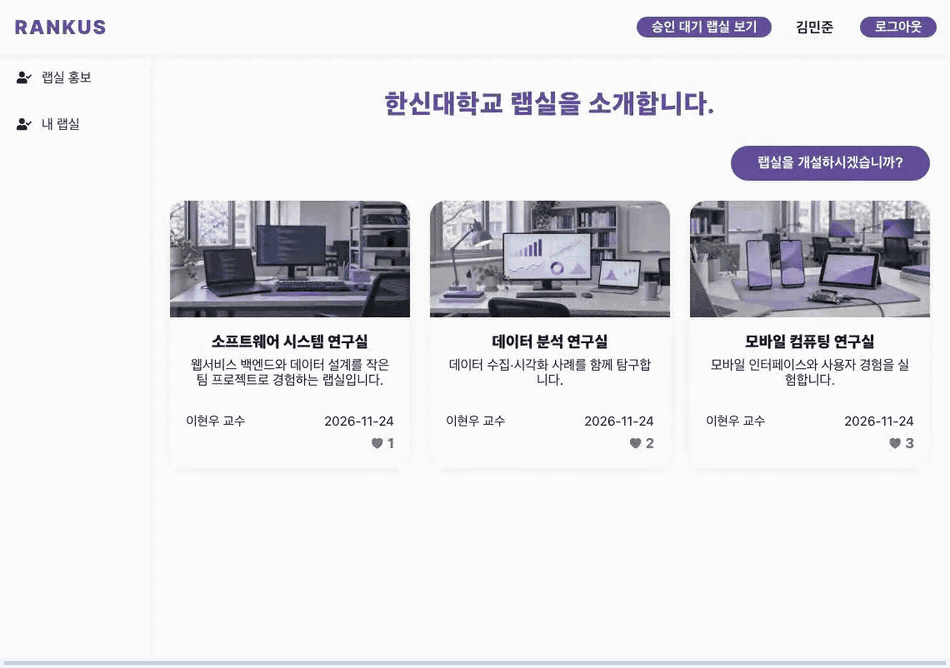
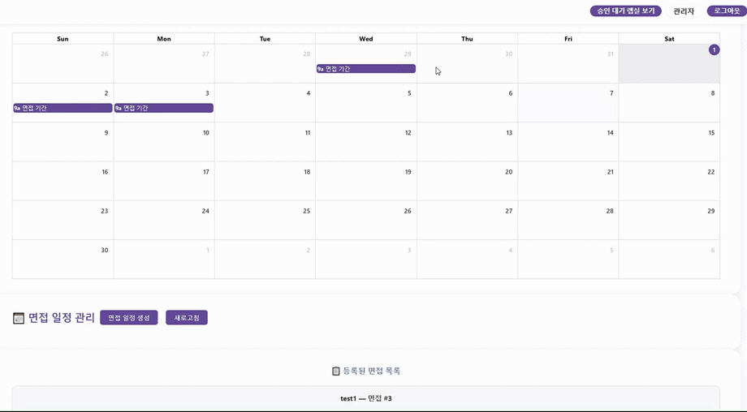
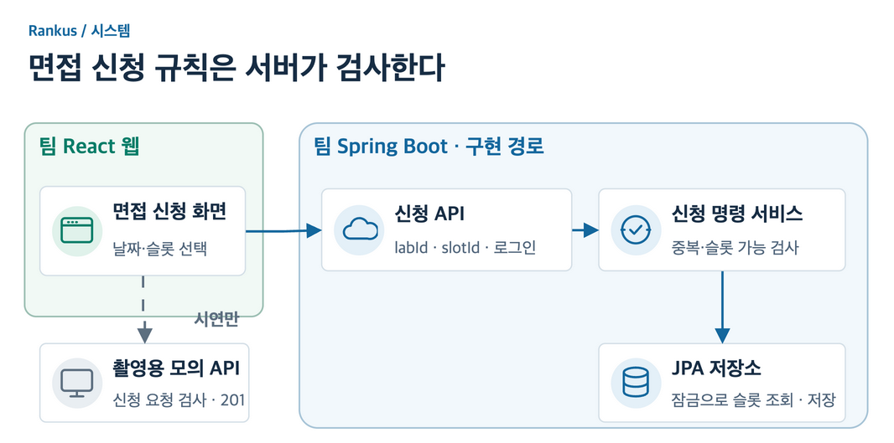
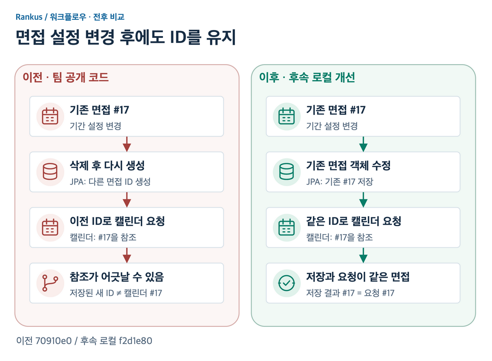
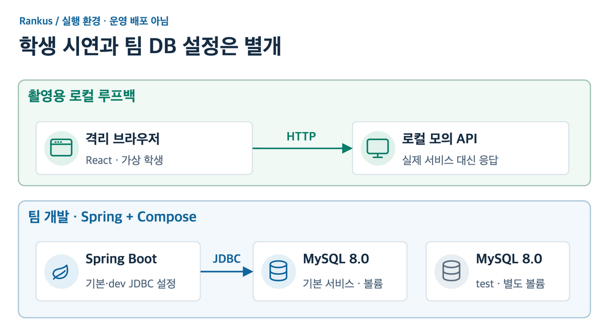

# Rankus | 대학 연구실 지원·면접 관리

연구실마다 따로 공지하고 조율하던 지원과 면접을 한곳에서 진행하는 대학 종합설계 프로젝트입니다. 학생은 관심 있는 연구실과 면접 시간을 선택해 지원하고, 연구실 운영진은 면접 일정과 슬롯을 관리합니다. 팀에서 Spring Boot 백엔드의 면접·캘린더 기능을 맡았고, 면접 설정이 바뀌어도 기존 연결을 유지하도록 수정 흐름을 개선했습니다.

[팀 백엔드 저장소](https://github.com/Hanshin-univ-Rankus/rankus-backend)

## 팀 React 웹 시연

### 학생: 연구실을 찾고 면접 신청하기

학생은 마감된 시간을 건너뛰고 14:30 면접 시간을 선택합니다. 신청을 제출하면 화면에 ‘가입 신청이 완료되었습니다!’가 표시됩니다.

[연구실 목록](demo/application-labs.png) · [연구실 상세](demo/application-detail.png) · [슬롯 선택](demo/application-slot.png) · [접수 완료](demo/application-success.png)

### 운영진: 면접 일정과 시간대 확인하기

운영진은 캘린더에서 면접을 열고 날짜별 시간대를 확인합니다.

[면접 캘린더](demo/interview-calendar.png) · [슬롯 관리](demo/interview-slots.png)

## Spring Boot 백엔드 · 담당 범위

React는 연구실과 면접 슬롯을 조회하고, 신청할 때 연구실 ID는 URL로, 선택한 슬롯 ID는 본문으로 보냅니다. Spring Boot의 명령 서비스가 신청 규칙을 적용하고, JPA가 신청과 슬롯을 저장합니다.

[편집 가능한 시스템 다이어그램](assets/rankus-system.drawio)

## 접수 시점에 면접 자리를 확정하기

기존 자유 입력 방식에서는 신청에 면접 시각만 들어갔습니다. 같은 시각이라도 연구실이나 면접이 다를 수 있고, 시각만으로는 해당 자리가 열려 있는지나 몇 명이 이미 신청했는지 알 수 없습니다. 신청이 운영진이 만든 **면접 슬롯을 직접 참조**하도록 바꿨습니다. 서버는 선택한 슬롯이 해당 연구실 면접에 속하는지 확인하고, 화면에 표시할 면접 시각은 그 슬롯에서 가져옵니다.

정원은 화면을 연 순간이 아니라 **신청을 저장할 때** 판정합니다. 마지막 한 자리에 두 사람이 동시에 신청할 수 있기 때문에, 신청 서비스에서 슬롯을 쓰기 잠금으로 조회한 뒤 가용 상태를 다시 확인합니다. 승인 대기 신청을 만들면서 같은 트랜잭션 안에서 슬롯의 예약 인원을 늘리고, 정원에 도달하면 슬롯을 마감합니다. 같은 시간대를 신청하는 요청은 잠금이 풀릴 때까지 기다리지만, 이미 열린 화면 때문에 마감된 자리를 다시 받는 문제를 막을 수 있습니다. 같은 학생의 한 연구실 중복 신청은 저장 전 검사에 더해 DB의 연구실·학생 조합 제약으로도 막습니다.

## 면접 기간을 변경해도 같은 일정으로 유지하기

운영진에게 면접 기간 수정은 이미 만들어진 면접의 설정을 바꾸는 일입니다. 그런데 [기존 구현](https://github.com/Hanshin-univ-Rankus/rankus-backend/blob/70910e0feef32f6044c03a23a997c1ebb5ea3ee7/rankus/src/main/java/org/univ/rankus/application/service/command/InterviewCommandService.java#L215-L247)은 기존 면접을 삭제하고 새 레코드를 만든 뒤, 캘린더에는 이전 ID를 전달했습니다. 수정과 캘린더 갱신이 서로 다른 면접을 가리킬 수 있는 구조였습니다.

후속 작업에서는 기존 면접 객체에서 날짜·시간·정원 검증을 거쳐 속성만 바꿉니다. 명령 서비스는 그 면접을 저장하고, 그대로 유지한 ID로 캘린더 갱신을 요청합니다. 면접의 식별자와 변경 가능한 설정을 나누면 호출하는 쪽에서도 기존 일정을 다시 찾아 연결할 필요가 없습니다.

캘린더는 면접과 별도의 이벤트를 저장하지만 이벤트의 연결 키는 면접 ID입니다. 그래서 수정 로직을 새 면접 생성이나 이벤트 재등록 경로와 분리했습니다. 단위 테스트도 날짜가 바뀌는지만 보지 않고, 면접을 삭제하지 않는지와 캘린더 갱신에 같은 ID를 전달하는지를 확인하도록 구성했습니다.

[편집 가능한 면접 수정 다이어그램](assets/rankus.drawio)

## 개발·시연 환경

팀 개발 환경에서는 Spring Boot가 JDBC로 MySQL 8.0에 연결되며, Docker Compose에서 기본 DB와 테스트용 DB를 별도로 띄울 수 있습니다. 학생 웹에서는 연구실과 면접 시간대를 선택해 접수 결과를 확인합니다.

[편집 가능한 환경 다이어그램](assets/rankus-environment.drawio) · [시연 재현 및 판본별 근거](docs/review-evidence.md)
